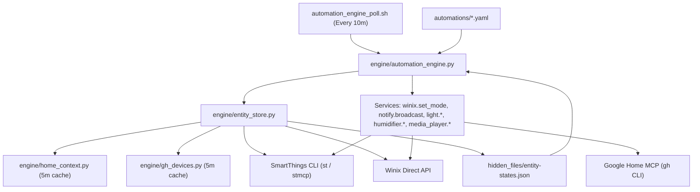

# Smart-Home Automation System for Muse Agents (Public Edition)

> **Important Notice — Fictional Placeholders:**
> All resident names (`Alex`), pet names (`pet`), coordinates (`0.0, 0.0`), device names (`Living Room Speaker`, `Bedroom Sensor`, `Living Room Streaming TV`), device IDs (`example-st-*`, `device@example-gh-*`, `example-winix-*`), and webhook URLs (`https://your-worker.example.com/...`) in this repository are **fictional placeholders**. Replace them with your own devices, locations, and credentials when adapting this system.

---

## What This Is

This repository is a generalized, reusable edition of a Muse user's smart-home automation layer. Modeled on Home Assistant's core abstractions (`entity_store` + declarative YAML `automations` + service wrappers), it runs directly inside a Muse agent workspace without requiring a dedicated local LAN Home Assistant box:

- **House Modes & Phone Sync:** Keeps SmartThings location modes (`Home`, `Away`, `Night`) and Android phone modes/routines in sync via a single universal MacroDroid webhook macro (`?do=mode&m=...`) plus a 5-minute poll backstop.
- **Multi-Source Presence & Context:** Combines phone geofence zone, SmartThings location mode, calendar blocks (sleep/work), room motion sensors, and SmartTag pet collar geofencing into a unified context snapshot (`engine/home_context.py`).
- **Spoken Alerts & Broadcast Routing:** Routes spoken notifications to Google Home speakers (`AssistantBroadcast`) when home and awake, or to phone TTS (`?do=speak`) for urgent alerts when away and not at work.
- **Cross-Platform Device Control:** Bridges SmartThings devices (multisensors, smart plugs/lamps, TVs, SmartTag trackers), Google Home-exclusive devices (speakers, washer/dryer, robot mop, Google TV streaming box), and direct vendor APIs (Winix air purifiers).
- **Zero-Token Steady-State Execution:** A lightweight bash poll hook (`engine/automation_engine_poll.sh`) runs the pure-Python automation engine every 10 minutes, waking the LLM agent **only** when an error occurs or when a speaker broadcast fires (to log the chat record).

---

## Architecture



### Repository Layout

```text
dist/
├── README.md                         # Overview, architecture, and setup guide
├── SCRUB-REPORT.md                   # Verification report of all scrubbed instance data
├── device-registry.example.json      # Cross-platform device registry schema with fictional IDs
├── engine/
│   ├── config.example.json           # Centralized configuration template
│   ├── automation_engine.py          # Declarative YAML trigger/condition/action evaluator
│   ├── entity_store.py               # Canonical entity state builder (entity-states.json)
│   ├── gh_devices.py                 # Google Home-exclusive device snapshot & trait reader
│   ├── home_context.py               # Presence, sleep, TV, work, and time-bucket context engine
│   ├── winix_controller.py           # Standalone CLI controller for Winix purifiers
│   └── automation_engine_poll.sh     # Zero-token hook script that wakes agent only on error/broadcast
├── automations/
│   ├── air-quality.yaml              # Interval rule: auto mode when sleeping/working/TV on, turbo otherwise
│   ├── laundry.yaml                  # State transition rule: speaker broadcast when washer/dryer finishes
│   └── pet.yaml                      # Presence rule: play comfort music on Google TV when pet is home alone
├── rules/
│   └── automation-rules.md           # Core architectural principles, presence voting, and alert routing
└── skills/
    ├── googlehome/
    │   └── SKILL.md                  # Google Home MCP control, broadcast routing, and actor census rules
    └── macrodroid/
        ├── SKILL.md                  # Universal webhook macro pattern (?do=mode|speak|status)
        └── schema-essentials.md      # MacroDroid 6.0 JSON serialization reference
```

---

## How to Adapt It to Your Home

### 1. Populate Your Device Registry & Engine Config
1. Copy `device-registry.example.json` to your smart-home goal directory (`hidden_files/device-registry.json`) and list your SmartThings, Google Home, and dual-platform devices.
2. Copy `engine/config.example.json` to `engine/config.json` (or point `SMART_HOME_CONFIG` to your config path) and update:
   - `timezone`: Your IANA timezone (e.g., `"America/Chicago"`, `"Europe/London"`).
   - `owner_key` / `pet_key`: Entity suffixes for `binary_sensor.<owner_key>_home` and `binary_sensor.<pet_key>_home`.
   - `home_location_id` & `primary_tv_st_id`: Your SmartThings location UUID and primary TV UUID.
   - `pet_home_lat` / `pet_home_lng` / `pet_collar_st_id`: Your home coordinates and SmartTag collar ID (or leave at `0.0` if unused).
   - `sensors`, `lamps`, `winix_purifiers`, `tv_st_ids`, `gh_tv_names`, `speakers`, and `gh_exclusive`: Your real device IDs and display names.

### 2. Environment Variables (Optional Overrides)
Every script in `engine/` reads `engine/config.json` (falling back to `engine/config.example.json`) and supports environment variable overrides:

| Variable | Purpose | Default |
|---|---|---|
| `SMART_HOME_CONFIG` | Path to JSON config file | `engine/config.json` |
| `SMART_HOME_GOAL_DIR` | Root directory for `hidden_files/` state | `~/workspace/goals/manage-my-smart-home` |
| `SMART_HOME_BIN_DIR` | Directory containing engine scripts | `engine/` directory |
| `SMART_HOME_AUTOMATIONS_DIR` | Directory containing `*.yaml` rules | `$SMART_HOME_GOAL_DIR/hidden_files/automations` |
| `SMART_HOME_ST_CLI` | Path to SmartThings CLI executable | `~/workspace/skills/smartthings/bin/st` |
| `SMART_HOME_GH_CLI` | Path to Google Home MCP CLI executable | `~/workspace/skills/googlehome/bin/gh` |
| `SMART_HOME_WINIX_LIB` | Path to Winix Python client library | `~/workspace/skills/winix/lib` |
| `SMART_HOME_TIMEZONE` | Household IANA timezone | Value in `config.json` (`America/New_York`) |

### 3. Customize Your Modes & Thresholds
- **Declarative Automations (`automations/*.yaml`):**
  - Edit entity names and target speakers in `automations/laundry.yaml`, `automations/air-quality.yaml`, and `automations/pet.yaml`.
  - Add new YAML files for lights, humidifiers, or nightly routines using `interval` or `state` triggers and `{{ python }}` templates.
- **Phone Webhook & Mode Sync (`skills/macrodroid/`):**
  - Follow [`skills/macrodroid/SKILL.md`](skills/macrodroid/SKILL.md) and [`skills/macrodroid/schema-essentials.md`](skills/macrodroid/schema-essentials.md) to build your universal `.macro` file (`?do=mode|speak|status`) and point it at your own Cloudflare Worker (`https://your-worker.example.com/...`).
- **Dry-Run Verification:**
  - Test entity collection and rule evaluation safely without sending commands to real devices:
    ```bash
    python3 engine/entity_store.py --fresh
    python3 engine/automation_engine.py --dry-run
    ```
